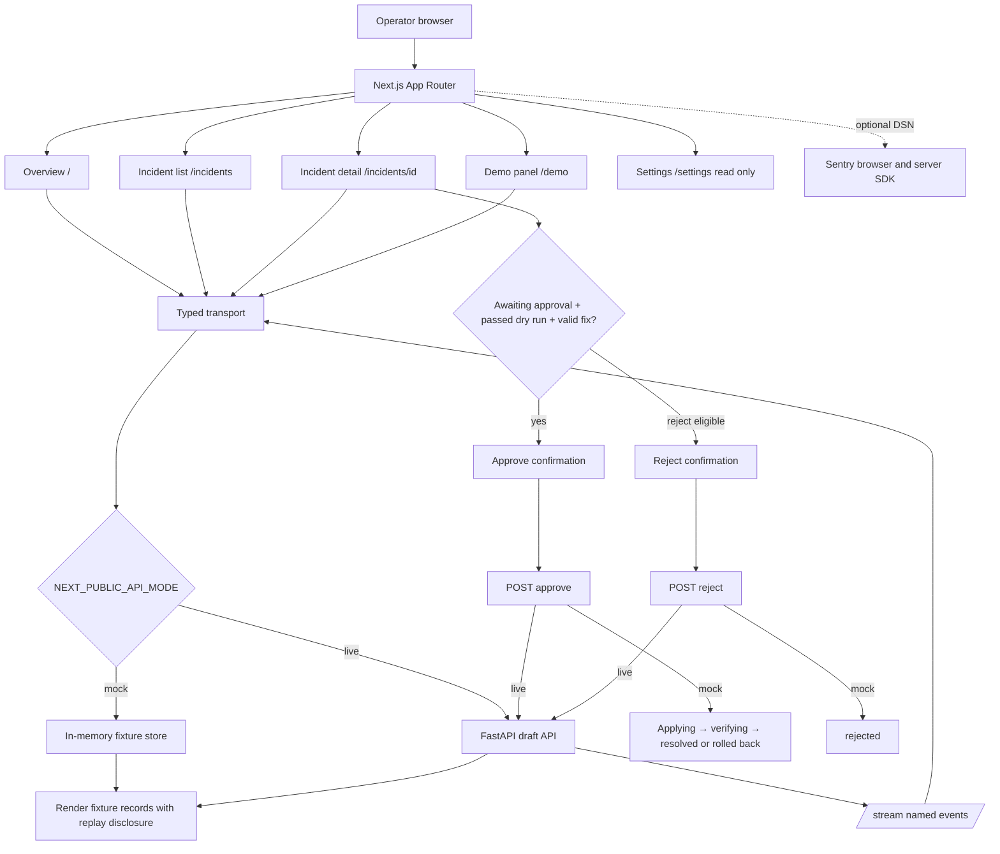

# Dashboard routes and walkthrough

## Route entry points and inputs

| Route             | Entry point                                      | User inputs                                              | Transport calls                                            | Visible result and errors                                                                                                                       |
| ----------------- | ------------------------------------------------ | -------------------------------------------------------- | ---------------------------------------------------------- | ----------------------------------------------------------------------------------------------------------------------------------------------- |
| `/`               | `app/page.tsx` → `Dashboard`                     | Choose a site card or incident                           | `sites()`, `incidents()`, `metrics(siteId)`, `subscribe()` | Site health, forecast chart, active incident links. Request failures show a retryable inline error.                                             |
| `/incidents`      | `app/incidents/page.tsx` → `IncidentList`        | Search text, site filter, status filter                  | `incidents(status, siteId)`                                | Newest-first incident table; error and empty states are distinct.                                                                               |
| `/incidents/[id]` | `app/incidents/[id]/page.tsx` → `IncidentDetail` | Copy commands, request voice alert, approve/reject       | `incident(id)`, `voice(id)`, `decide(id, decision)`        | Evidence, timeline, fix/rollback, test result, optional upstream link. Mock voice clearly reports unavailable; live voice requests the API MP3. |
| `/demo`           | `app/demo/page.tsx` → `DemoPanel`                | Site, one of seven scenarios or normal traffic, duration | `inject(siteId, scenario, duration)`                       | Fixture creates a reviewable incident or an advice-only message. Failure stays visible.                                                         |
| `/settings`       | `app/settings/page.tsx`                          | None                                                     | None                                                       | Read-only explanation until backend settings contract exists; there is no fake save button.                                                     |

## Transport and lifecycle

`lib/transport.ts` implements the `Transport` interface. Live mode uses GET `/sites`, GET `/metrics?site_id=…&series=probe%3A1.1.1.1%3Artt_ms&from=<ISO>&to=<ISO>`, GET `/incidents?status=…`, GET `/incidents/{id}`, GET `/incidents/{id}/voice` (audio blob), POST `/demo/scenarios`, POST `/incidents/{id}/approve`, POST `/incidents/{id}/reject`, and EventSource GET `/stream`. Decision POST bodies are treated only as acknowledgements: the app immediately GETs `/incidents/{id}` and renders that authoritative record. Scenario injection POST is also treated as an acknowledgement; the app says diagnosis is queued and links to the incident list rather than treating the response as an incident. Each fetch has a seven-second abort timeout; OpenAPI download is separately bounded to ten seconds. A failed live request raises an error; there is no fixture fallback. These payload mappings are provisional until OpenAPI is available. The metrics key currently uses the documented `probe:<target>:rtt_ms` pattern and remains provisional until the published schema confirms it. Run `OPENAPI_URL=<published-schema-url> npm run api:types` to generate a separate type file once Aun publishes the schema. No generated types are currently present.

The stream subscribes to `metric`, `incident.opened`, `incident.updated`, `fix.tested`, and `fix.applied`. Any event causes a route refresh. Repeated event IDs are ignored in the current connection. EventSource reconnects itself; both `onerror` and a later `onopen` trigger a refresh so recovery is reflected. Component cleanup removes listeners and closes the connection. Server event IDs, replay and heartbeat behavior remain an integration question.

In mock mode, injection adds a browser-memory incident for each of the seven catalog scenarios; normal traffic produces no incident. The three notify-only causes and an uplink failure at Market Cafe (which has no configured backup) use `template: none`, have no router commands, and cannot be approved. Actionable mock incidents show clearly simulated test evidence. Approval is possible only when the status is `awaiting_approval`, the test passed, and the template and command list are valid. A confirmation dialog precedes approve/reject, and a synchronous busy guard prevents repeat submissions. Mock approval exposes applying, verifying, then either resolved or rolled-back states according to the chosen scenario; rejection records rejected. Site cards reflect active replayed incidents. These timers model a workflow and do not contact CHR or a physical router.

The optional Sentry SDK is initialized from `NEXT_PUBLIC_SENTRY_DSN` in the browser and `SENTRY_DSN` on the server. No PII capture is enabled in the app. Without a DSN no event is sent; the UI does not claim connection or verification.

## Dependency audit boundary

`npm audit` reports five high findings for one advisory: `braces@3.0.3` (stack exhaustion on deeply nested brace patterns), pulled only through the Next.js ESLint toolchain (`eslint-config-next` → `@next/eslint-plugin-next` → `fast-glob` → `micromatch` → `braces`). The advisory has no patched package version. npm's suggested fix is the incompatible `eslint-config-next@14.2.35` downgrade from the app's Next.js 16 setup, so the lockfile is left intact. This toolchain is a development dependency; `npm audit --omit=dev` reports zero vulnerabilities. See [the advisory](https://github.com/advisories/GHSA-vfj7-8cjw-p6xm) and [upstream issue](https://github.com/micromatch/braces/issues/84). Recheck after an upstream release or dependency chain change.
