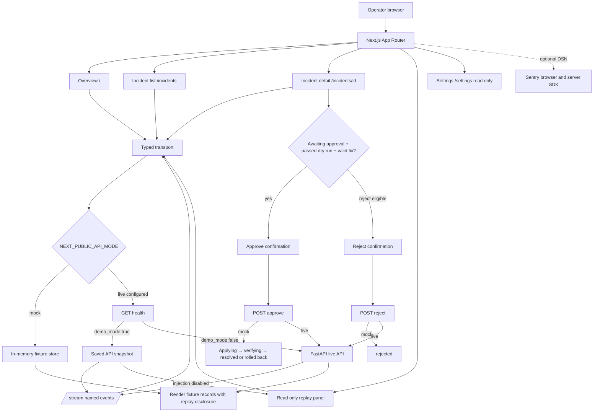

# Dashboard routes and walkthrough

## Route entry points and inputs

| Route             | Entry point                                      | User inputs                                              | Transport calls                                            | Visible result and errors                                                                                                      |
| ----------------- | ------------------------------------------------ | -------------------------------------------------------- | ---------------------------------------------------------- | ------------------------------------------------------------------------------------------------------------------------------ |
| `/`               | `app/page.tsx` → `Dashboard`                     | Choose a site card or incident                           | `sites()`, `incidents()`, `metrics(siteId)`, `subscribe()` | Site health, forecast chart, active incident links. Request failures show a retryable inline error.                            |
| `/incidents`      | `app/incidents/page.tsx` → `IncidentList`        | Search text, site filter, status filter                  | `incidents(status, siteId)`                                | Newest-first incident table; error and empty states are distinct.                                                              |
| `/incidents/[id]` | `app/incidents/[id]/page.tsx` → `IncidentDetail` | Copy commands, approve/reject                            | `incident(id)`, `decide(id, decision)`                     | Evidence, timeline, fix/rollback, test result, optional upstream link. Customer messages remain readable English or Urdu text. |
| `/demo`           | `app/demo/page.tsx` → `DemoPanel`                | Site, one of seven scenarios or normal traffic, duration | `inject(siteId, scenario, duration)`                       | Fixture creates a reviewable incident or an advice-only message. Failure stays visible.                                        |
| `/settings`       | `app/settings/page.tsx`                          | None                                                     | None                                                       | Read-only explanation until backend settings contract exists; there is no fake save button.                                    |

## Transport and lifecycle

`lib/transport.ts` implements the `Transport` interface. Live mode uses generated API `components` and `paths` types for GET `/health`, `/sites`, `/metrics?site_id=…&series=probe%3A1.1.1.1%3Artt_ms&from=<ISO>&to=<ISO>`, `/incidents?status=…`, `/incidents/{id}`, POST `/demo/scenarios`, POST `/incidents/{id}/approve`, POST `/incidents/{id}/reject`, and EventSource GET `/stream`. Site and incident records are explicitly adapted from API shapes; primary and backup uplinks use their `role` and `iface` fields, and absent site location/subscriber data renders as unavailable. Metric actuals and forecast bands are joined by timestamp and sorted chronologically. Decision POST bodies are acknowledgements only; the app immediately GETs the incident and renders that authoritative record. Scenario injection is read only in API replay mode. Ordinary GET requests have a seven-second deadline; potentially Temporal-backed POSTs have a 30-second deadline and are never retried. A failed API request stays visible; the app never falls back to fixtures.

The stream subscribes to `metric`, `incident.opened`, `incident.updated`, `fix.tested`, and `fix.applied`. Any event causes a route refresh. Dashboard metrics also refresh on a 30-second interval. Repeated event IDs are ignored in the current connection. EventSource reconnects itself; both `onerror` and a later `onopen` trigger a refresh so recovery is reflected. Component cleanup removes listeners, closes the connection and clears refresh timers.

In mock mode, injection adds a browser-memory incident for each of the seven catalog scenarios; normal traffic produces no incident. The three notify-only causes and an uplink failure at Market Cafe (which has no configured backup) use `template: none` and have no router commands. Approval is possible only when status is `awaiting_approval`, the router test passed, and the template and command list are valid. Rejection is also limited to `awaiting_approval`, matching the API. A confirmation dialog precedes either decision, and a synchronous busy guard prevents repeat submissions. Mock approval exposes applying, verifying, then either resolved or rolled-back states. These timers model a workflow and do not contact CHR or a physical router. In API replay mode, the panel lists real API sites but disables scenario injection; approval records the decision in the saved in-memory snapshot only. In operational API mode, injection targets the simulator and approved commands may be applied to the connected CHR.

The optional Sentry SDK is initialized from `NEXT_PUBLIC_SENTRY_DSN` in the browser and `SENTRY_DSN` on the server. No PII capture is enabled in the app. Without a DSN no event is sent; the UI does not claim connection or verification.

## Dependency audit boundary

`npm audit` reports five high findings for one advisory: `braces@3.0.3` (stack exhaustion on deeply nested brace patterns), pulled only through the Next.js ESLint toolchain (`eslint-config-next` → `@next/eslint-plugin-next` → `fast-glob` → `micromatch` → `braces`). The advisory has no patched package version. npm's suggested fix is the incompatible `eslint-config-next@14.2.35` downgrade from the app's Next.js 16 setup, so the lockfile is left intact. This toolchain is a development dependency; `npm audit --omit=dev` reports zero vulnerabilities. See [the advisory](https://github.com/advisories/GHSA-vfj7-8cjw-p6xm) and [upstream issue](https://github.com/micromatch/braces/issues/84). Recheck after an upstream release or dependency chain change.
