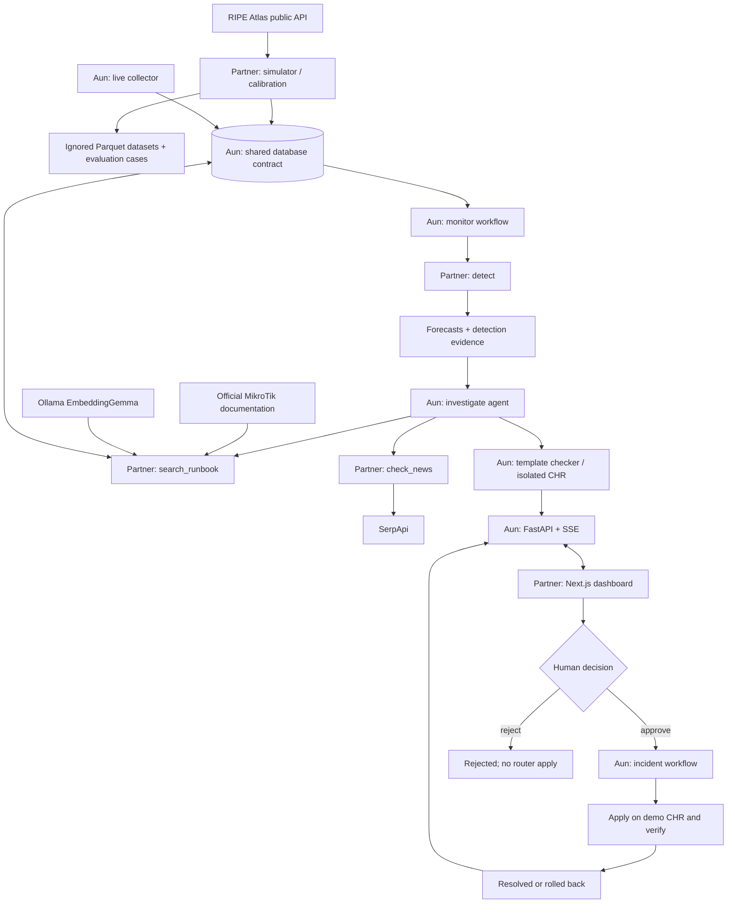

# NetCortex: entry points, connections and exits

This map distinguishes the partner's code from Aun's shared runtime.
Package `flow.md` files give exact implementation-level names and examples.
This document is updated as each component is integrated.

## Entry and exit points

| Entry | Inputs | Connection / processing | Exit |
| --- | --- | --- | --- |
| `simgen ripe` | requested days, cache location | Discover PK probes/measurements; bounded RIPE downloads | Local raw dataset with source provenance; error on unavailable API |
| `simgen calibrate` | real baseline rows, optional exact target-role map and explicit proxy opt-in | Group statistics by target and Pakistan hour; restrict proxy transfer to public DNS ping roles | Calibration/report with coverage, defaults, source targets and transfer uncertainty |
| `simgen generate` | days, seed, scenario configuration | Seeded demand/noise and incident transforms | Probe/interface Parquet plus separate expected labels |
| `simgen replay` / `inject` | site, cause, duration, seed | Active simulator runtime; DB writes need Aun's keys/runtime agreement | Current metrics and scenario label; explicit missing-runtime/contract failure |
| `detect(site_id, window, history)` | observed shared MetricsWindow | Lag features -> prepared TabPFN forecasts/anomaly/cause | Shared DetectionResult, or unavailable error; worker owns forecast writes |
| `search_runbook(query, k)` | question and result count | Ollama query embedding -> pgvector retrieval | Shared RunbookChunk objects with source URLs |
| `check_news(provider, target)` | upstream provider/target | Recent SerpApi search | Shared NewsCheck with links; explicit unavailable summary on failure |
| Dashboard navigation | site/incident selection | Fixture transport or Aun's HTTP API | Rendered status/evidence, loading state or visible error |
| Dashboard decision | confirmed approve/reject | POST to Aun; GET authoritative incident after acknowledgement; workflow owns subsequent state | Acknowledged decision, followed by SSE/refetch; no assumed live success |
| Evaluation runner | held-out case directory and mode | Detector, then Aun's agent/checker when available | Markdown/structured results with actual measurements and pending gates |

## HTTP boundary owned by Aun

The draft API exposes `GET /sites`, `/metrics`, `/incidents`,
`POST /incidents/{id}/approve`, `/incidents/{id}/reject`, and
`POST /demo/scenarios`. Actual response types will come from Aun's API OpenAPI when published.
SSE event names are `metric`, `incident.opened`, `incident.updated`, `fix.tested`
and `fix.applied`. Reconnect must refresh state; repeated event IDs must not
repeat effects. Settings reads/writes are a pending contract.

## Fixture and live exits

Fixture mode uses explicitly simulated data and transitions and displays
"Demo: replayed data". It does not apply router commands or establish provider,
model or API integration. Live mode reports a failed dependency instead of
switching to fixture data. Approval requires a valid actionable plan with a
passing CHR check and an appropriate incident state.

## Hosting and validation boundary

Render runs the dashboard's Node/Next.js server. Aun supplies the API service;
the browser does not hold database or provider secrets. Sentry receives optional
frontend monitoring when configured. CI checks offline Python/frontend behavior;
the separate CHR workflow boots a pinned router and checks authenticated REST.
Its template job runs only when Aun's actual test harness exists; boot success
alone does not establish template validity. External authentication is setup,
not an automatic claim of a working connection.

## Merged core boundary

simgen.inject enters a site-locked transaction, preserves existing Site topology,
inserts sim ProbeMetric/IfaceMetric/SubscriberMetric observations and one
ScenarioLabel, then commits or rolls back together. DNS uses kind=dns and target
dns:1.1.1.1. The detector consumes actual MetricsWindow inputs and returns
DetectionResult with canonical SeriesForecast/ForecastPoint data. detect performs
no forecast writes; MonitorSiteWorkflow owns persistence. Core exposes fetch_site.

The detector needs an explicitly prepared real TabPFN context for cloud/local
inference. Gate 2 will prepare it from TRAIN and normal VALIDATION observations,
without reading TEST labels at inference. Provider failures remain unavailable.

Gate 2 entry is `python eval/gate2.py`. It calls `prepare_detector(cases, artifact)`
for TRAIN/VALIDATION JSON and Parquet, then `configure_detector(artifact)` to fit
and cache the real provider. The runner seeds bounded simulated history for
north-tower, calls public simgen inject, and fetches only past source=sim rows
through core's database pool. Public detect returns a core DetectionResult;
the runner validates provenance, quantiles and horizons and compares forecast
row counts. Exit is a sanitized JSON/Markdown report with measured timing and
an explicit pass or failure. No migrations or live-router operations occur.

The merged CHR template CI path generates a masked job-only router password,
calls `infra/chr/chr.py start` to provision the canonical three-NIC baseline,
then runs `infra/chr/test_templates.py` for actual apply/export/rollback checks.
It retains the QEMU log and structured test report and always calls canonical
stop. The old one-NIC bootstrap remains a separate missing-harness boot smoke.
