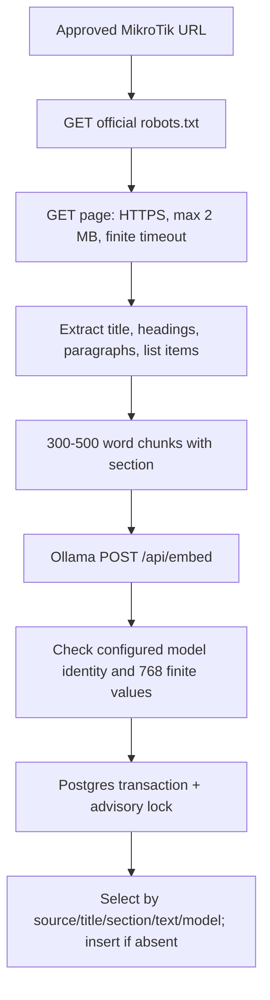

# Runbook execution flow

## Entry points

- `python -m netcortex_runbook.cli fixture "failover default route" --mock [-k 3]` performs offline lexical fixture search. `--mock` is required by the CLI.
- `netcortex_runbook.service.fixture_search(query, k=3)` is the same fixture adapter in Python.
- `netcortex_runbook.search_runbook(query, k=5)` is the public live function. It requires Aun's published `netcortex_core.Settings` and `netcortex_core.RunbookChunk` and settings fields `database_url`, `ollama_base_url`, `embed_model`.
- `netcortex_runbook.ingest(database_url=..., ollama_base_url=..., embed_model=...)` fetches and indexes the finite source allowlist. It can take an injected `httpx.Client` for tests. The model argument is required; no default tag is assumed before Aun confirms it.

## Live indexing path

Only `help.mikrotik.com` URLs are accepted. Current source areas are queues, route, DNS, and mangle. Ollama is called at `<OLLAMA_BASE_URL>/api/embed` with `{model, input}` using the explicit configured full model tag. The tag must be in the `embeddinggemma` family, the response tag must match exactly, and the first embedding must have 768 finite numeric values. PostgreSQL writes only `runbook_chunks(id, source_url, title, section, text, embedding, embed_model)`; the vector is serialized for pgvector. Same-content rows with the same model tag are left untouched; another tag is a distinct row. The batch is one transaction with a 5-second statement timeout and connect timeout and rolls back on failure.

## Live query path

`search_runbook` validates non-empty query and `k` from 1 through 20, imports the actual core contracts, checks the configured tag, embeds the query, and selects the nearest rows with `ORDER BY embedding <=> query_vector LIMIT k`. It returns a list of core `RunbookChunk` objects with source URL and `score=1-distance`. There is no keyword mode.

Input validation raises `ValueError`; blocked robots, HTTP/database/model errors, dimension mismatch, or tag mismatch fail explicitly. Missing core exports/settings raise `RuntimeError` naming the unavailable contract. No fallback fixture result is returned from the live function. The offline CLI makes no network or database request and marks every result as a fixture.
